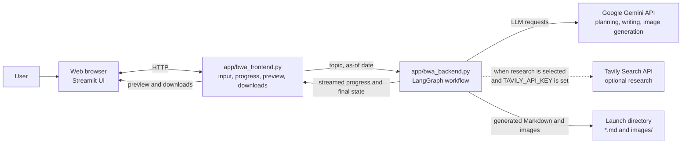
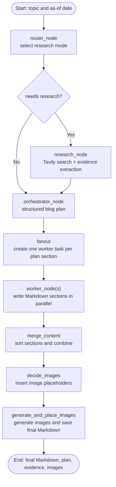

# LangGraph Blog Writing Agent

A Streamlit application that uses a LangGraph workflow to plan and generate technical blog posts. It can route topics through optional web research, create sections in parallel, and propose and generate supporting images. Completed posts can be previewed and downloaded as Markdown or as a ZIP bundle.

## Contents

- [Features](#features)
- [Architecture](#architecture)
- [Project layout](#project-layout)
- [Requirements](#requirements)
- [Configure API keys](#configure-api-keys)
- [Run the application](#run-the-application)
- [Run on another device](#run-on-another-device)
- [Use the notebooks](#use-the-notebooks)
- [Generated files and paths](#generated-files-and-paths)
- [Git ignore guidance](#git-ignore-guidance)
- [Troubleshooting](#troubleshooting)
- [Limitations and next steps](#limitations-and-next-steps)

## Features

- Streamlit interface with tabs for the plan, research evidence, Markdown preview, images, and run logs.
- Gemini-powered topic routing, structured outline planning, and section writing.
- Optional Tavily search for topics that need current information.
- Parallel section generation with LangGraph fan-out and reduction.
- Optional image planning and Gemini image generation (up to three proposed images).
- Markdown and image ZIP downloads; the app also writes the generated Markdown and images to disk.
- A sidebar that discovers Markdown posts saved in the application's current working directory.
- Six Jupyter notebooks showing earlier or experimental versions of the workflow.

## Architecture

### Runtime components



### LangGraph generation flow



The frontend calls the compiled graph with the topic and selected date. The router chooses one of three modes:

- **closed_book**: evergreen topic; skips web research.
- **hybrid**: combines evergreen writing with recent examples and research.
- **open_book**: volatile or news-oriented topic; research is date-filtered to a recent window.

The planner returns a typed plan. LangGraph fans its section tasks out to workers, then the reducer sorts the completed sections by task ID, combines them, asks whether visuals would help, and writes the final Markdown. The UI displays graph progress and exposes the final plan, evidence, Markdown, and image artifacts.

If Tavily is not configured or returns no results, research evidence is empty; the application can still continue to planning and writing. Image generation uses the Google API key and is optional to the overall output: if an image request fails, the Markdown includes a failure notice instead of that image.

## Project layout

```text
.
├── app/
│   ├── bwa_backend.py          # LangGraph nodes, schemas, API calls, file output
│   ├── bwa_frontend.py         # Streamlit UI, preview, downloads, past-blog listing
│   └── __init__.py
├── notebooks/
│   ├── 1_bwa_basic.ipynb
│   ├── 2_bwa_improved_prompting.ipynb
│   ├── 3_bwa_research.ipynb
│   ├── 4_bwa_research_fine_tuned.ipynb
│   ├── 5_bwa_image.ipynb
│   └── tavily_test.ipynb
├── .env.example                # Environment-variable template; copy to .env
├── .gitignore                  # Local environments, credentials, and generated artifacts
├── requirements.txt            # Main Streamlit app dependencies
├── requirements-notebooks.txt  # Main dependencies plus notebook tooling
└── README.md
```

## Requirements

- Python 3.10 or newer.
- A Google AI API key for the main application.
- A Tavily API key is optional; without it, current-web research will not provide search evidence.
- Internet access to call configured model and search APIs.

The notebook examples also use OpenAI in addition to the dependencies of the main application.

## Configure API keys

From the project root, make a local environment file from the template:

**Windows PowerShell**

```powershell
if (-not (Test-Path .env)) { Copy-Item .env.example .env }
```

**macOS / Ubuntu / other Unix-like shells**

```sh
test -f .env || cp .env.example .env
```

Edit `.env` and provide the key(s) for the services you intend to use:

```dotenv
GOOGLE_API_KEY=your_google_ai_api_key
TAVILY_API_KEY=your_tavily_api_key
OPENAI_API_KEY=your_openai_api_key
```

- `GOOGLE_API_KEY` is required by the main app's Gemini chat model and Gemini image generation.
- `TAVILY_API_KEY` is optional for web research.
- `OPENAI_API_KEY` is used by the OpenAI-based notebook examples, not by the main app.

Keep real credentials in `.env` or another local secret store. Do not paste real keys into notebooks, commit them, or include them in screenshots or logs. `.env.example` contains placeholders only.

## Run the application

Run all commands from the **project root** (the directory containing `README.md`, `app/`, and `requirements.txt`). The current file paths are relative to that working directory.

### Windows

In PowerShell:

```powershell
py -3 -m venv .venv
.\.venv\Scripts\Activate.ps1
python -m pip install --upgrade pip
python -m pip install -r requirements.txt
if (-not (Test-Path .env)) { Copy-Item .env.example .env }
python -m streamlit run app/bwa_frontend.py
```

If PowerShell blocks virtual-environment activation, either permit locally created scripts for your user with `Set-ExecutionPolicy -ExecutionPolicy RemoteSigned -Scope CurrentUser`, or use Command Prompt instead:

```bat
py -3 -m venv .venv
.venv\Scripts\activate.bat
python -m pip install --upgrade pip
python -m pip install -r requirements.txt
if not exist .env copy .env.example .env
python -m streamlit run app/bwa_frontend.py
```

After creating `.env`, edit it to add the API keys before generating a blog.

### macOS

Install Python 3.10+ if necessary (for example, from python.org or Homebrew), then run in Terminal:

```sh
python3 -m venv .venv
source .venv/bin/activate
python -m pip install --upgrade pip
python -m pip install -r requirements.txt
test -f .env || cp .env.example .env
python -m streamlit run app/bwa_frontend.py
```

Edit `.env` to add your API keys before generating a blog.

### Ubuntu

Install Python and virtual-environment support if needed:

```sh
sudo apt update
sudo apt install python3 python3-venv python3-pip
```

Then, from the project root:

```sh
python3 -m venv .venv
source .venv/bin/activate
python -m pip install --upgrade pip
python -m pip install -r requirements.txt
test -f .env || cp .env.example .env
python -m streamlit run app/bwa_frontend.py
```

Edit `.env` to add your API keys before generating a blog. These instructions also apply to Ubuntu under WSL.

### Other Linux distributions

Install Python 3.10+ and that distribution's `venv` support (package names vary), then use the Ubuntu virtual-environment, install, and launch commands above.

When Streamlit starts, open the local URL it prints, usually <http://localhost:8501>. Enter a topic, choose an as-of date, and select **Generate Blog**.

## Run on another device

The app is a web app: only the computer running Streamlit needs Python and the project dependencies. A phone, tablet, or another computer can use a modern browser on the same local network.

1. Start the app on the host computer from the project root, listening on the network:

   ```sh
   python -m streamlit run app/bwa_frontend.py --server.address 0.0.0.0 --server.port 8501
   ```

   The same command works in Windows PowerShell, macOS, and Linux when the virtual environment is active.
2. Find the host computer's private LAN IP address (for example, `192.168.1.25`).
3. From the other device on the same trusted network, open `http://192.168.1.25:8501`, substituting the host's actual IP.
4. If the connection fails, check that both devices are on the same network and allow inbound TCP port `8501` in the host's firewall.

Do not expose this development server directly to the public internet. Public deployment requires an appropriately secured host, HTTPS, authentication/access control, and safe secret management. A remote device running only a browser does not need a local Python installation.

## Use the notebooks

The notebooks are independent learning/experimental versions; they are not needed to run the Streamlit app. Their earlier workflows use `langchain-openai`; the Tavily and image examples additionally use search or image-related integrations.

Install the notebook dependencies from the project root:

```sh
python -m pip install -r requirements-notebooks.txt
python -m jupyter lab
```

Alternatively, run `python -m jupyter notebook`. In Jupyter, open a notebook under `notebooks/` and select the kernel for this project's `.venv`. The examples that call OpenAI need `OPENAI_API_KEY`; research examples need `TAVILY_API_KEY`. Not all notebooks load `.env` themselves: either export the required variables in the shell before starting Jupyter, or add `from dotenv import load_dotenv; load_dotenv()` in a notebook cell before the API calls.

## Generated files and paths

The application currently uses the process's **current working directory**:

- Final blog: `<launch directory>/<slugified-blog-title>.md`
- Generated image files: `<launch directory>/images/<image filename>`
- Past-blog sidebar: scans `*.md` in the launch directory
- Image preview and ZIP bundle: reads the `images/` directory in the launch directory

Launch from the project root so generated files are easy to find and the frontend and backend resolve the same `images/` folder. These are not currently configurable with an environment variable.

If you want to change the output location, update the path handling consistently in:

- `app/bwa_backend.py`: `generate_and_place_images` writes the Markdown file and creates/writes files under `images/`.
- `app/bwa_frontend.py`: `list_past_blogs`, `render_markdown_with_local_images`, and the image/ZIP display code resolve the Markdown and image paths.

For example, changing only the backend's image directory would leave the Markdown image links, preview, and ZIP downloads pointing at the old directory. Keep the Markdown link prefix (currently `images/<filename>`) aligned with the actual location. Do not delete a path from the code unless all readers/writers that depend on it have been updated.

## Git ignore guidance

The `.gitignore` in this repository excludes local virtual environments, Python caches, local secrets, notebook checkpoints, editor/OS files, and generated image assets. The `/images/` rule treats generated images as local output; remove that rule if you intentionally want to version generated images. Generated Markdown files are **not** blanket-ignored, so you can choose whether a particular article belongs in version control.

Never ignore or delete `.env.example`; it is the safe template that documents required environment variable names.

## Troubleshooting

- **`GOOGLE_API_KEY` missing or authentication error:** check that `.env` exists in the project root and contains a valid key. Restart Streamlit after changing environment variables.
- **No research evidence:** confirm `TAVILY_API_KEY` is set and valid. Research is optional, and search failures can result in an empty evidence list while the graph continues.
- **Notebook reports a missing package:** activate the project environment and rerun `python -m pip install -r requirements-notebooks.txt`; confirm Jupyter is using that same environment's kernel.
- **Module import error when starting the UI:** run the Streamlit command from the project root exactly as shown.
- **Images or past posts not found:** check the current working directory and the documented `images/` and root-level Markdown paths.
- **Port already in use:** choose another port, for example `python -m streamlit run app/bwa_frontend.py --server.port 8502`, then use the URL Streamlit prints.

## Limitations and next steps

- This repository does not include an automated test suite or a dependency lock file.
- Dependency requirements are intentionally unpinned; for a reproducible deployment, test and lock a known-good dependency set.
- Output names are derived from blog titles. Generating another post with the same title writes to the same Markdown path; existing image files are reused rather than overwritten.
- The experimental notebooks may have different API or dependency requirements from the main app.
- For a production service, consider adding tests, explicit error reporting/retry policy for external API calls, per-run output directories, and authenticated deployment.
