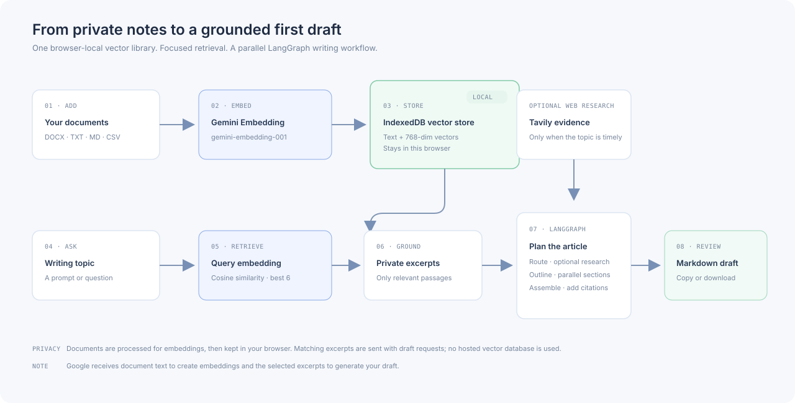
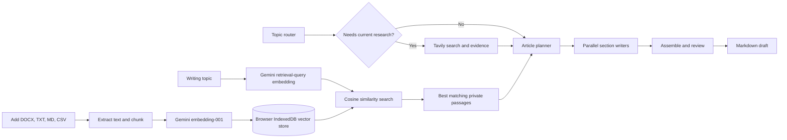

# InkForge

InkForge is a focused AI writing workspace. Give it a topic and it creates a structured Markdown article. Add your own DOCX, text, Markdown, or CSV files to ground the draft in private notes and research.

The project uses **FastAPI + LangGraph on Python**, a lightweight browser frontend, **Google Gemini** for writing and embeddings, and **Vercel** for deployment. Python dependencies and the lockfile are managed with **uv**.



## What it does

- Uses a product-style welcome hero and a focused writing room, with InkForge's own identity and blue accents.
- Plans a useful article outline, routes timely topics to optional web research, writes sections in parallel, and assembles a Markdown draft.
- Accepts private DOCX, TXT, Markdown, and CSV documents through the **＋ Add documents** control.
- Chunks documents and creates 768-dimension embeddings with Google's `gemini-embedding-001` model.
- Keeps document text and vectors in the visitor's browser using IndexedDB. There is no hosted vector database account, separate database service, or database connection to configure.
- Embeds the topic as a retrieval query, ranks the local vectors with cosine similarity, and adds up to six relevant passages to the article plan and section writers.
- Lets the visitor remove library documents, copy the draft, or download it as Markdown.
- Keeps a visitor's Google AI key in that browser tab's session storage. The key survives refreshes in the tab session and is removed when the session ends or the visitor forgets it.

## How the workflow works

The full workflow illustration is [`docs/workflow.svg`](docs/workflow.svg).



### Data flow and privacy

1. When a visitor adds a document, its contents are uploaded as a bounded JSON request to the InkForge API for text extraction and sent to Google AI to create embeddings. The API returns text chunks and vectors; the browser saves them in IndexedDB.
2. When the visitor generates a draft, the browser sends its saved vectors to the API. The API creates an embedding for the topic, finds the closest passages, and supplies only the best matches to the writing workflow.
3. Google AI receives the selected passages as part of the writing prompts. If Tavily research is enabled, the topic's search queries are also sent to Tavily.
4. InkForge does not save uploaded documents, vectors, or visitor keys on the server. Vercel functions are stateless and their filesystem is ephemeral. The local browser library is per browser profile/device; clearing site data removes it, and it is not synchronized across devices.

**Do not upload material that you are not comfortable processing with Google AI.** Document storage is local to the browser, but embedding and generation send relevant text to Google's API. Provider free-tier availability and quotas can change; check your Google AI project's current limits.

## Project structure

```text
.
├── backend/
│   ├── main.py             # FastAPI routes: health, ingestion, generation, frontend
│   ├── rag.py              # File extraction, chunking, Gemini embeddings, retrieval
│   └── workflow.py         # LangGraph router, research, planning, parallel writers
├── docs/
│   └── workflow.svg        # Architecture and data-flow illustration
├── frontend/
│   ├── index.html          # Minimal writing workspace and private-library UI
│   ├── styles.css          # Responsive blue-and-white workspace styling
│   └── app.js              # Session key, IndexedDB vectors, API calls, draft export
├── index.py                # Vercel Python entry point
├── vercel.json             # Static asset inclusion and function duration
├── pyproject.toml          # uv project metadata and dependencies
├── uv.lock                 # Reproducible dependency resolution for deployment
├── .python-version         # Python version selected by uv and Vercel
├── .env.example            # Safe environment-variable template
└── README.md
```

## Run locally with uv

Install [uv](https://docs.astral.sh/uv/) if it is not already installed. From the repository root, let uv install/use the project's Python 3.12 and synchronize the locked dependencies:

```powershell
uv python install 3.12
uv sync --locked
```

On macOS or Linux, the same commands work in a shell:

```bash
uv python install 3.12
uv sync --locked
```

Create a local `.env` file and put your Google AI key there if you want a server-side default. Otherwise, run the app and enter a key in the browser when prompted.

```powershell
if (-not (Test-Path .env)) { Copy-Item .env.example .env }
```

Example `.env` (use your own key; never commit this file):

```dotenv
GOOGLE_API_KEY=your_google_ai_api_key
TAVILY_API_KEY=your_tavily_api_key
```

`TAVILY_API_KEY` is optional. Without it the workflow can still create evergreen drafts and use the private document library, but it cannot fetch current web sources.

Start the application:

```powershell
uv run uvicorn index:app --reload
```

Then open <http://127.0.0.1:8000>. The API health check is <http://127.0.0.1:8000/api/health>; the interactive API docs are at <http://127.0.0.1:8000/docs>.

### Local library behavior

The first page load opens the Google AI key panel if no key exists for the current tab session. Add a key, then use **＋ Add documents** in the sidebar. Supported file types are DOCX, TXT, Markdown, and CSV; each file is limited to 3 MB to stay within serverless request limits, and a browser library stores at most 120 chunks. Re-adding a document with the same filename replaces it. Remove a file with the × beside its name. The library remains available in that browser profile after refresh and browser restarts until site data is cleared.

## Deploy to Vercel

1. Push this repository to GitHub and import it in Vercel. Use the repository root as the **Root Directory**.
2. Keep the Python runtime on **3.12** (`.python-version`). Vercel installs the locked dependencies from `pyproject.toml` and `uv.lock`.
3. Add `GOOGLE_API_KEY` under **Project Settings → Environment Variables** only if you want a server-side default. The UI can instead ask each visitor for their own session key. Add `TAVILY_API_KEY` if you want optional web research.
4. Deploy. The same Vercel project serves the static workspace and the FastAPI routes.

No database URL, vector database API key, or rewrite to `index.py` is required. `vercel.json` packages the `frontend/` assets with the Python function. After changing environment variables, redeploy so the deployment receives the new values.

Keep real keys in `.env` locally or in Vercel's environment settings. `.env`, `.env.*` except `.env.example`, `.vercel/`, and `.uv-cache/` are ignored by Git. Never put a real key in source code, `vercel.json`, frontend JavaScript, or README examples. Rotate any key that has been exposed in a public repository or message.

## API

### `GET /api/health`

Returns `{"status":"ok","service":"inkforge"}`.

### `POST /api/ingest`

Accepts JSON with `filename` and `content_base64` fields, plus the `X-Google-API-Key` header. Returns extracted passages with their Gemini embeddings for browser-local storage. Supported suffixes: `.docx`, `.txt`, `.md`, `.markdown`, `.csv`.

### `POST /api/generate`

Accepts JSON and the `X-Google-API-Key` header. `private_chunks` is optional and contains the current browser's locally stored text/vector pairs.

```json
{
  "topic": "How retrieval-augmented generation keeps AI answers grounded",
  "private_chunks": []
}
```

Returns the article title, Markdown, writing mode, web evidence, image suggestions, and number of private passages retrieved. API keys are used for the request and are not written to disk by the backend.

## Main technologies

- **Python 3.12 + uv** — project runtime and locked dependency management.
- **FastAPI** — API endpoints and static site delivery.
- **LangGraph** — routing, optional research, outline planning, parallel section generation, and draft assembly.
- **Google Gemini** — planning and writing; `gemini-embedding-001` powers document retrieval.
- **IndexedDB** — zero-cost browser-local storage for document chunks and vectors.
- **Tavily** — optional current web research.
- **Vercel** — deploys the frontend and Python API together.

## Notes

The generated draft is a starting point. Review factual claims and citations before publishing. Image suggestions are represented as notes in the Markdown response; image files are not created or persisted by the Vercel deployment.\n
